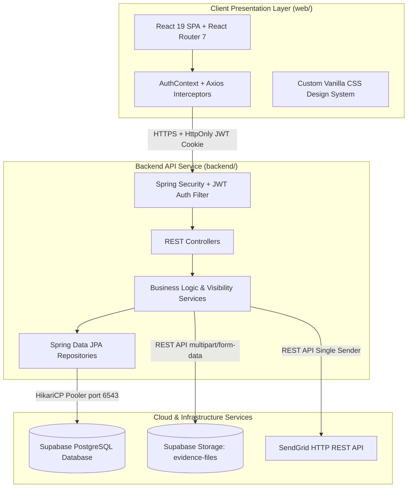
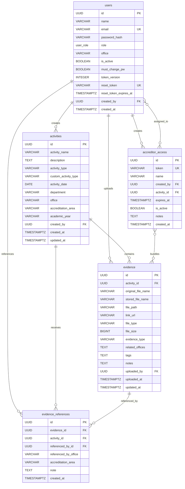

# AERCS — Accreditation Evidence Repository and Coordination System

[](https://spring.io/projects/spring-boot)
[](https://www.oracle.com/java/)
[](https://react.dev/)
[](https://reactrouter.com/)
[](https://supabase.com/)
[](#)

> **A centralized, enterprise-grade web platform designed to streamline institutional accreditation evidence management across academic departments, service offices, and external accreditation bodies (e.g., PACUCOA, PAASCU, CHED).**

---

## Table of Contents

- [1. Executive Summary & Problem Solved](#1-executive-summary--problem-solved)
- [2. System Architecture](#2-system-architecture)
- [3. Key Features](#3-key-features)
- [4. User Roles & Permission Matrix](#4-user-roles--permission-matrix)
- [5. Institutional Taxonomy & Enums](#5-institutional-taxonomy--enums)
- [6. Core Functional Modules](#6-core-functional-modules)
- [7. Technology Stack](#7-technology-stack)
- [8. Database Schema & Data Models](#8-database-schema--data-models)
- [9. REST API Reference](#9-rest-api-reference)
- [10. Local Development Setup](#10-local-development-setup)
- [11. Environment Variables](#11-environment-variables)
- [12. Production Deployment & Docker](#12-production-deployment--docker)
- [13. Testing](#13-testing)
- [14. Capstone Project Team](#14-capstone-project-team)

---

## 1. Executive Summary & Problem Solved

### The Problem
During college and university accreditation cycles, evidence gathering is traditionally plagued by:
- **Fragmented Storage**: Documents are scattered across personal Google Drive folders, USB thumb drives, local desktop computers, and endless email attachments.
- **Redundant Uploads**: Common institutional policies, university handbooks, safety certificates, and library facilities reports are repeatedly re-uploaded across every single department, consuming massive storage and creating multiple inconsistent versions.
- **Access Control Challenges**: Granting external evaluators and accreditors temporary access to sensitive documents typically involves sharing unrestricted drive folders or emailing confidential PDFs.
- **Missing Metadata**: Files lack standard accreditation area classifications, academic year tagging, and ownership metadata, causing intense last-minute panic before visits.

### The AERCS Solution
**AERCS (Accreditation Evidence Repository and Coordination System)** transforms accreditation readiness into a continuous, structured, and auditable process:
- **Department-Scoped Workspaces**: Academic departments maintain complete control over their own activities while having instant access to institutional and public service documents.
- **Zero-Duplication Cross-Referencing**: Departments can search the central repository and link existing files directly into their activities without duplicating file storage.
- **Time-Bounded Accreditor Portals**: Generates dedicated, expiring access packages assigned to registered accreditor accounts with direct email dispatch.
- **Live Readiness Dashboard**: Real-time analytics tracking total activities, evidence uploads, missing metadata alerts, and expiring evaluator links.

---

## 2. System Architecture

AERCS is built on a modern decoupled architecture separating the presentation layer, the Spring Boot application server, and Supabase cloud services.



### Architectural Highlights
- **Stateless Authentication with HttpOnly Cookies**: Uses cryptographically signed JWT tokens stored in strict `HttpOnly`, `SameSite` cookies with token versioning for instant server-side revocation.
- **Transaction-Safe Connection Pooling**: Configured with HikariCP in transaction mode over port `6543` to operate safely within cloud database connection constraints.
- **HTTP-Based Email Delivery**: Integrates SendGrid's REST API directly over HTTPS, bypassing blocked outbound SMTP ports on cloud container environments (such as Render).

---

## 3. Key Features

- **Department-Scoped Workspace & Navigation**:
  - Staff and Chairpersons see only their department's activities plus public service office activities.
  - Multi-college institutions remain strictly segregated to ensure data privacy between colleges.
- **Chairperson Administrative Delegation**:
  - Chairpersons can invite and manage members within their department (`Department Staff`, `Chairperson`, `Accreditor`) without needing institution-wide superadmin privileges.
- **Unified Evidence Repository**:
  - Centralized catalog allowing users to discover and inspect existing evidence files across eligible departments and service offices.
- **Evidence Cross-Referencing**:
  - Enables one-click referencing of institutional files (e.g., Library reports, campus safety clearances) into departmental activities, maintaining an audit trail of which departments cite which files.
- **Outbound Reference Tracker ("Shared Evidence")**:
  - Tracks which outside departments are currently citing your department's evidence, providing verifiable proof of institutional impact for accreditation criteria.
- **Secure Accreditor Link Management**:
  - Generate customized evidence bundles assigned to accreditors with custom expiration dates and automated invitation emails.
- **Dedicated Accreditor Portal**:
  - Accreditors receive clean, clutter-free access showing only the specific evidence bundles assigned to their account.
- **Batch Metadata Tagging**:
  - Bulk apply accreditation areas, evidence types, and tags to multiple uploaded files simultaneously.

---

## 4. User Roles & Permission Matrix

AERCS implements a granular 5-tier Role-Based Access Control (RBAC) model:

| Capability | Administrator (`ADMIN`) | Chairperson (`ACCRED_COORDINATOR`) | Department Staff (`DEPT_STAFF`) | Institutional Office (`INSTITUTIONAL_OFFICE`) | Accreditor (`ACCREDITOR_LINK`) |
| :--- | :---: | :---: | :---: | :---: | :---: |
| **Activity Visibility** | All University | Own Dept + Public Offices | Own Dept + Public Offices | All University | Assigned Links Only |
| **Create Activities** | ❌ (Governance) | ✅ (Own Dept) | ✅ (Own Dept) | ✅ (Own Office) | ❌ |
| **Edit / Delete Activities** | ✅ (All) | ✅ (Own Dept only) | ✅ (Own activities) | ✅ (Own office) | ❌ |
| **Upload Evidence** | ❌ (Moderates) | ✅ (Own Dept) | ✅ (Own Dept) | ✅ (Own Office) | ❌ |
| **Access Repository** | ✅ (Global) | ✅ (Scoped) | ✅ (Scoped) | ✅ (Global) | ❌ |
| **Reference Evidence** | ✅ | ✅ | ✅ | ✅ | ❌ |
| **Generate Accreditor Links** | ✅ | ✅ | ✅ | ✅ | ❌ |
| **Access Management (`/admin/users`)** | ✅ (Institution-wide) | ✅ (Own Dept only) | ❌ | ❌ | ❌ |
| **Assignable Roles** | All Roles | `Staff`, `Chairperson`, `Accreditor` | None | None | None |
| **Dedicated Evaluator Portal** | ❌ | ❌ | ❌ | ❌ | ✅ (`/accreditor`) |

---

## 5. Institutional Taxonomy & Enums

AERCS utilizes strict domain models reflecting Philippine higher education accreditation frameworks:

### Academic Departments
- `CCS` — College of Computer Studies
- `CEA` — College of Engineering and Architecture
- `CMBA` — College of Management, Business, and Accountancy
- `CASE` — College of Arts, Sciences, and Education
- `CNAHS` — College of Nursing and Allied Health Sciences
- `CCJ` — College of Criminal Justice
- `CES` — College of Environmental Studies

### Institutional Offices
- `QUALITY_ASSURANCE_OFFICE`
- `RESEARCH_OFFICE`
- `HUMAN_RESOURCE_OFFICE`
- `FACILITIES_MANAGEMENT_OFFICE`

### Public Service Offices *(Accessible to all departments)*
- `LIBRARY`
- `GUIDANCE_CENTER`
- `REGISTRARS_OFFICE`
- `STUDENT_SUCCESS_OFFICE`
- `MEDICAL_DENTAL_CLINIC`
- `TECHNICAL_SUPPORT_GROUP`
- `SAFETY_AND_SECURITY`
- `ADMISSIONS_AND_SCHOLARSHIPS`
- `NATIONAL_SERVICE_TRAINING_PROGRAM`

### Accreditation Areas
`FACULTY` · `INSTRUCTION` · `LIBRARY` · `LABORATORIES` · `FACILITIES` · `STUDENT_SERVICES` · `RESEARCH` · `EXTENSION` · `ADMINISTRATION`

### Evidence Types
`REPORT` · `CERTIFICATE` · `ATTENDANCE_SHEET` · `PHOTO` · `MEMORANDUM` · `PRESENTATION` · `EVALUATION` · `OTHER`

---

## 6. Core Functional Modules

### 1. Dashboard (`/dashboard`)
The central mission control for faculty and administrators:
- **Metrics Overview**: Total activities, uploaded evidence count, missing metadata count, and access links expiring within 7 days.
- **Evidence Insights**: Highlights most referenced institutional evidence and provides personalized evidence recommendations.
- **Action Trackers**: Quick-filtered lists of activities lacking evidence, activities missing accreditation metadata, and recent uploads.

### 2. Activity Documentation (`/activities`)
The core repository of departmental milestones:
- Comprehensive activity logging with date, academic year, accreditation area, and custom activity types.
- Advanced filtering by type, department, academic year, and area.
- Direct evidence attachment panel for instant uploads or Google Drive link association.

### 3. Evidence Management (`/activities/:id`)
- Supports direct file uploads up to 10MB (PDF, DOCX, XLSX, JPG, PNG) and external cloud storage links.
- Batch metadata modal: select multiple files to simultaneously apply evidence type, tags, and related office cross-shares.

### 4. Cross-Office Repository (`/repository`)
- Eliminates file duplication across campus.
- Staff browse existing files from eligible departments and service offices.
- One-click **"Reference to Activity"** creates an instant reference link without duplicating binary files in cloud storage.

### 5. Shared Evidence Tracker (`/shared-evidence`)
- Institutional collaboration dashboard.
- Displays all files owned by your department that have been referenced by outside colleges or activities.
- Displays live reference counts and detailed citation logs.

### 6. Accreditor Access Management (`/accreditor`)
- Empowers staff to bundle activities and evidence files for external accreditors.
- Custom validity durations with expiration date guards.
- Automatically sends transactional email invitations containing personal login instructions.

### 7. User Management (`/admin/users`)
- **Dual-Scope Governance**:
  - **Administrators**: Create, modify, suspend, or reset any user account institution-wide.
  - **Chairpersons**: Access Management view pre-filtered and locked to their department, allowing autonomous faculty onboarding.
- **Bulk Invitation**: Paste comma-separated lists of names and emails for rapid department onboarding.
- **Forced Password Reset**: Secure temporary password generation with mandatory change on first login.

---

## 7. Technology Stack

### Frontend
| Component | Technology | Description |
| :--- | :--- | :--- |
| Framework | **React 19.2.6** | Modern functional components with hooks |
| Routing | **React Router 7.15.1** | Declarative route guards and nested layouts |
| HTTP Client | **Axios 1.16.1** | Configured with `withCredentials: true` for cookie handling |
| Icons | **Lucide React 1.48.0** | Clean, accessible iconography |
| Styling | **Vanilla CSS** | Tailored design system, responsive grids, and dark accents |

### Backend
| Component | Technology | Description |
| :--- | :--- | :--- |
| Framework | **Spring Boot 3.2.5** | High-performance Java microframework |
| Language | **Java 17 (LTS)** | Modern Java features (Records, Pattern Matching) |
| Security | **Spring Security 6** | Cookie-based JWT filter chain and method-level `@PreAuthorize` |
| ORM | **Spring Data JPA / Hibernate** | Relational mapping, Specifications, and dynamic queries |
| Pooler | **HikariCP** | Highly optimized JDBC connection pooling |
| Utilities | **Lombok** | Boilerplate reduction for entities and DTOs |

### Cloud & Database
| Service | Provider | Description |
| :--- | :--- | :--- |
| Relational DB | **Supabase PostgreSQL** | Transaction-mode pooler on port 6543 |
| Object Storage | **Supabase Storage** | `evidence-files` bucket for binary evidence |
| Transactional Mail | **SendGrid REST API** | Single Sender Verification email dispatch |

---

## 8. Database Schema & Data Models



---

## 9. REST API Reference

### Authentication (`/api/auth`)
| Method | Endpoint | Description | Access |
| :--- | :--- | :--- | :--- |
| `POST` | `/api/auth/login` | Authenticate user, set HttpOnly cookie | Public |
| `POST` | `/api/auth/logout` | Invalidate cookie session | Public |
| `GET` | `/api/auth/me` | Retrieve authenticated profile | Authenticated |
| `POST` | `/api/auth/change-password` | Update user password | Authenticated |
| `POST` | `/api/auth/forgot-password` | Request password reset token | Public |
| `POST` | `/api/auth/reset-password` | Reset password using email token | Public |

### Dashboard (`/api/dashboard`)
| Method | Endpoint | Description | Access |
| :--- | :--- | :--- | :--- |
| `GET` | `/api/dashboard/summary` | Fetch overview statistics and queues | Staff / Admin |

### Activities (`/api/activities`)
| Method | Endpoint | Description | Access |
| :--- | :--- | :--- | :--- |
| `GET` | `/api/activities` | List scoped activities | Staff / Admin |
| `POST` | `/api/activities` | Create a new activity | Staff / Chairperson |
| `GET` | `/api/activities/{id}` | Retrieve activity details | Staff / Admin |
| `PUT` | `/api/activities/{id}` | Update activity | Creator / Admin / Chairperson |
| `DELETE` | `/api/activities/{id}` | Delete activity (without evidence) | Creator / Admin / Chairperson |

### Evidence & Repository (`/api/evidence`)
| Method | Endpoint | Description | Access |
| :--- | :--- | :--- | :--- |
| `POST` | `/api/activities/{id}/evidence/upload` | Upload binary evidence file | Staff / Chairperson |
| `POST` | `/api/activities/{id}/evidence/link` | Attach Google Drive / web link | Staff / Chairperson |
| `GET` | `/api/activities/{id}/evidence` | List evidence for activity | Staff / Admin |
| `GET` | `/api/evidence/{id}/download` | Download binary file | Staff / Admin |
| `PUT` | `/api/evidence/{id}/metadata` | Update evidence metadata | Uploader / Chairperson |
| `PUT` | `/api/evidence/metadata/batch` | Batch update evidence metadata | Uploader / Chairperson |
| `DELETE` | `/api/evidence/{id}` | Delete evidence file | Uploader / Chairperson / Admin |
| `GET` | `/api/evidence/repository` | Search cross-office repository | Staff / Admin |
| `GET` | `/api/evidence/shared` | Search outbound referenced evidence | Staff / Admin |
| `POST` | `/api/evidence/{id}/reference` | Reference evidence into activity | Staff / Chairperson |
| `DELETE` | `/api/evidence/references/{id}` | Remove evidence reference link | Same Office / Admin |

### Accreditor Access (`/api/accreditor-access` & `/api/accreditor`)
| Method | Endpoint | Description | Access |
| :--- | :--- | :--- | :--- |
| `POST` | `/api/accreditor-access/generate` | Generate access link bundle | Staff / Chairperson / Admin |
| `GET` | `/api/accreditor-access/links` | List manageable access links | Staff / Chairperson / Admin |
| `PUT` | `/api/accreditor-access/links/{id}` | Update link metadata or expiry | Creator / Chairperson / Admin |
| `DELETE` | `/api/accreditor-access/links/{id}` | Deactivate access link | Creator / Chairperson / Admin |
| `GET` | `/api/accreditor/links` | List assigned evaluator links | Accreditor (`ACCREDITOR_LINK`) |
| `GET` | `/api/accreditor/links/{id}` | View evidence bundle | Accreditor (`ACCREDITOR_LINK`) |

### User Management (`/api/admin/users`)
| Method | Endpoint | Description | Access |
| :--- | :--- | :--- | :--- |
| `GET` | `/api/admin/users` | List users (scoped for Chairperson) | Admin / Chairperson |
| `POST` | `/api/admin/users` | Create single user account | Admin / Chairperson |
| `POST` | `/api/admin/users/batch` | Bulk invite users | Admin / Chairperson |
| `PUT` | `/api/admin/users/{id}/role` | Update user role | Admin / Chairperson |
| `PUT` | `/api/admin/users/{id}/department` | Update user office | Admin only |
| `POST` | `/api/admin/users/{id}/reset-password` | Issue temporary password | Admin / Chairperson |
| `PUT` | `/api/admin/users/{id}/toggle-active` | Activate / Suspend account | Admin / Chairperson |
| `DELETE` | `/api/admin/users/{id}` | Delete user account | Admin / Chairperson |

---

## 10. Local Development Setup

### Prerequisites
- **Java 17 (JDK)** installed and on PATH
- **Node.js 18+** & **npm 9+**
- **Git**

### 1. Clone the Repository
```bash
git clone https://github.com/fishdips/AERCS.git
cd AERCS
```

### 2. Backend Setup
1. Open a terminal in the `backend/` directory:
   ```bash
   cd backend
   ```
2. Verify Java installation:
   ```bash
   java -version  # Must be Java 17
   ```
3. Set your local environment variables (PowerShell example):
   ```powershell
   $env:DB_PASSWORD="your-supabase-db-password"
   $env:JWT_SECRET="your-256-bit-hex-or-base64-secret-key"
   $env:SUPABASE_SERVICE_ROLE_KEY="your-supabase-service-role-key"
   ```
4. Run the backend server:
   ```powershell
   .\mvnw.cmd spring-boot:run
   ```
   *The backend will boot up on `http://localhost:8080`.*

> [!TIP]
> **Offline Development**: To run without connecting to live Supabase, activate the in-memory H2 profile:
> ```powershell
> .\mvnw.cmd spring-boot:run "-Dspring-boot.run.profiles=h2"
> ```

### 3. Frontend Setup
1. Open a new terminal in the `web/` directory:
   ```bash
   cd web
   ```
2. Install dependencies:
   ```bash
   npm install
   ```
3. Start the React development server:
   ```bash
   npm start
   ```
   *The web app will launch automatically on `http://localhost:3000`.*

---

## 11. Environment Variables

| Variable | Required | Default / Example | Purpose |
| :--- | :---: | :--- | :--- |
| `PORT` | No | `8080` | Backend HTTP listening port |
| `DB_PASSWORD` | **Yes** | — | PostgreSQL database user password |
| `JWT_SECRET` | **Yes** | — | Secret key for signing HS256 JWT tokens |
| `SUPABASE_SERVICE_ROLE_KEY` | **Yes** | — | Supabase admin key for storage bucket upload/download |
| `SENDGRID_API_KEY` | No | — | SendGrid API key for invitation and reset emails |
| `MAIL_FROM` | No | `olodinkrizza@gmail.com` | Verified SendGrid sender email address |
| `CORS_ALLOWED_ORIGINS` | No | `http://localhost:3000` | Comma-separated list of permitted frontend URLs |
| `COOKIE_SECURE` | No | `true` (prod) / `false` (dev) | Set to `false` for local HTTP dev; `true` for HTTPS |
| `COOKIE_SAME_SITE` | No | `None` (prod) / `Lax` (dev) | Cookie cross-site policy |
| `REACT_APP_API_URL` | No | *Current Host:8080* | Frontend base URL for backend API |

---

## 12. Production Deployment & Docker

### Multi-Stage Dockerfile
The backend includes a production-optimized multi-stage `Dockerfile`:

```dockerfile
# Build Stage
FROM eclipse-temurin:17-jdk AS build
WORKDIR /app
COPY mvnw .
COPY .mvn .mvn
COPY pom.xml .
RUN chmod +x mvnw && ./mvnw -B dependency:go-offline
COPY src ./src
RUN ./mvnw -B clean package -DskipTests

# Runtime Stage
FROM eclipse-temurin:17-jre
WORKDIR /app
COPY --from=build /app/target/aercs-backend-0.0.1-SNAPSHOT.jar app.jar
EXPOSE 8080
ENTRYPOINT ["java", "-jar", "app.jar"]
```

### Build & Run Container
```bash
# Build image
docker build -t aercs-backend ./backend

# Run container
docker run -d -p 8080:8080 \
  -e DB_PASSWORD="your-db-password" \
  -e JWT_SECRET="your-jwt-secret" \
  -e SUPABASE_SERVICE_ROLE_KEY="your-supabase-key" \
  --name aercs-api aercs-backend
```

### Cloud Production Notes (e.g., Render)
1. **Database Connections**: Always use Supabase transaction pooler port `6543`. Direct connection pool limits can cause `EMAXCONNSESSION` errors under load.
2. **CORS & Cookies**: In cross-origin deployments (e.g., frontend on Vercel/Netlify and backend on Render), set `COOKIE_SECURE=true` and `COOKIE_SAME_SITE=None`.
3. **Outbound Mail**: Do not use standard SMTP port 587/465 on container platforms that block SMTP. AERCS uses direct SendGrid HTTP REST API calls to ensure guaranteed email delivery.

---

## 13. Testing

### Backend Test Suite
Run JUnit 5 and Spring Boot integration tests:
```powershell
# Run with H2 in-memory test profile
cd backend
.\mvnw.cmd test "-Dspring.profiles.active=h2"
```

### Frontend Test Suite
Run Jest and React Testing Library tests:
```bash
cd web
npm test -- --watchAll=false
```

---

## 14. Capstone Project Team

AERCS was conceptualized and developed as a Bachelor of Science in Information Technology (BSIT) Capstone Project.

* **Repository**: [https://github.com/fishdips/AERCS](https://github.com/fishdips/AERCS)
* **Academic Year**: 2024 – 2026

---

*© AERCS Development Team. All rights reserved.*
